<!-- Typing animation -->

 

<!-- Profile badges -->

  

<!-- Profile views -->

##  About Me

<b>Plain-text version</b>

- **Who:** ML & AI Engineer · MS Computer Science, NJIT · NYC metro, open to relocating anywhere in the US
- **Focus:** production ML · LLM agents & RAG · causal inference · deep learning
- **What I bring to a team:** I take a problem from raw data to a model, an API and a live deployment, and I audit my own work. I found 12 defects in LoanLens, a label leak in SessionScout and a biased "ground truth" in a 14M-row benchmark. Then I fixed them and added tests.
- **Looking for:** ML Engineer · AI Engineer · GenAI Engineer · Forward Deployed Engineer roles, startups included
- **Contact:** mohammed.ahmeduddin16@gmail.com

##  Key Metrics

| 🎯 Best test AUC | ⚡ Latency | 📊 Largest dataset | 🏥 Real records | ✅ Tests | 📦 Live deployments |
|:---:|:---:|:---:|:---:|:---:|:---:|
| **0.958** | **27 ms** | **14M rows** | **39,694** | **623** | **4** |
| SessionScout LSTM | Redis-cached API | LiftLab · Criteo | CareAgent · CMS providers | across 4 ML projects | Hugging Face + GCP |

##  Featured ML Projects

### 🟢 CareAgent — Multi-Agent Analysis of Medicare Billing

> A LangGraph supervisor routes 5 agents over **39,694 real New Jersey Medicare providers** (CMS 2024, **$4.78B** in payments).
> - **Peer comparison:** providers are compared within their specialty (71 specialties) after adjusting for patient risk. It flags **1,461 outliers (3.7%)**, each with reasons drawn from the data, and an independent Isolation Forest agrees (outliers sit at the 96th percentile of its score vs the 48th).
> - **Checked LLM summaries:** every number in an LLM summary is checked against the data in code.
> - **Caching:** a fingerprinted cache cuts repeat requests from **4.7 s to 0.83 s with 0 tokens**.

-10b981?style=flat-square)

`LangGraph` `OpenAI` `Isolation Forest` `FastAPI` `PostgreSQL` `GCP Cloud Run` `Secret Manager`

---

### 🩷 LoanLens — Explainable, Fair-Lending-Aware Credit Risk

> An XGBoost credit-risk model on **307,511 loan applications** (16M+ joined rows).
> - **Calibrated:** predicted default rate 0.080 vs actual 0.081.
> - **Fair-lending checks:** sex, marital status and age were removed at a cost of **0.004 AUC**, and the four-fifths rule check passes (0.95 vs the 0.80 threshold).
> - **Explanations:** SHAP values become CFPB adverse-action reason codes, retrieved by RAG over **9,977 CFPB regulation chunks**. Every citation and reason is verified in code.
> - **Self-audit:** found and fixed **12 defects**.

`XGBoost` `SHAP` `RAG` `ChromaDB` `OpenAI` `dbt` `PostgreSQL` `FastAPI` `MLflow`

---

### 🔵 SessionScout — Real-Time E-Commerce Purchase Prediction

> A 4-model cascade (Logistic Regression → XGBoost → LSTM → Transformer) in PyTorch on **241K sessions**. The LSTM reaches **0.958 test AUC**.
> - **Label leak found:** live-demo testing exposed a leak that marked **5,640 buyer sessions**. The pipeline was rebuilt and retrained, and regression tests now guard against it.
> - **Serving:** FastAPI with Redis caching in Docker responds in **27 ms**.

`PyTorch` `LSTM` `Transformer` `XGBoost` `FastAPI` `Redis` `Docker` `HuggingFace`

---

### 🟣 LiftLab — Causal Inference on 14M Real Ad-Campaign Users

> Measures how much ads **caused** visits and conversions on the full Criteo Uplift dataset (**13,979,592 users**).
> - **Randomization check:** the dataset isn't fully randomized. A classifier predicts who was treated (AUC 0.510, vs at most 0.5014 with shuffled labels), so the raw comparison overstates the visit effect by **39%**. Cross-fitted **AIPW** is used as the reference instead.
> - **Targeting:** one quarter of users produce **~94%** of the extra conversions. A Causal Forest ranks users with a held-out Qini of **0.339**.
> - **Validated first:** every estimator is checked on simulated data with a known answer before it touches real data.

`EconML` `DoWhy` `AIPW` `Causal Forest` `scikit-learn` `FastAPI` `Streamlit`

## 🧭 How I Build

| Practice | Example from my work |
|---|---|
| **Audit before claiming** | LoanLens: an inverted SHAP sign made every denial list the applicant's *strengths*; found, fixed, regression-tested |
| **Calibrate, then decide** | Replacing inflated scores with calibrated ones cut applicants sent away from auto-approval from 46% to 8.7% |
| **Verify LLM output in code** | LoanLens checks every regulation the LLM cites against the retrieved passages; the decision still works if the LLM is down |
| **Question the data** | LiftLab: a randomization check on 14M rows showed the "ground truth" itself was biased |
| **Honest metrics** | CareAgent: renamed a "quality score" to a billing-pattern comparison, because Medicare billing data has no outcomes |
| **Bound LLM cost and latency** | CareAgent reuses summaries keyed by a SHA-256 fingerprint of model + prompt + facts, with a 45 s time budget and per-client rate limits |
| **Ship with CI** | Lint, tests and coverage gates on every pull request |

## 🗂️ More Projects

| Project | Description | Stack | Links |
|---------|-------------|-------|-------|
| **AI Financial Report Analyst** | Breaks down the change in net income between two quarterly-report PDFs into revenue, margin, opex, tax and other drivers that fully reconcile. Optional LLM commentary is limited to those drivers, with citations from the Statements of Operations | FastAPI · React · OpenAI · pdfplumber |   |
| **AI Money Brain** | Personal-finance API: bank and card CSV import, LLM transaction categorization with keyword fallback, spending analytics, JWT auth | FastAPI · PostgreSQL · Alembic · OpenAI · Docker |  |
| **Developer Portfolio Tracker** | React dashboard: protected routes, search and filters, CRUD forms, skill charts, dark mode | React · TypeScript · Vite · Recharts |   |
| **User Management** *(NJIT course project)* | User and event-management service built on course base code: fixed 7 issues (JWT errors, email-verification order, password rules, logging), added profile management and 31 tests | FastAPI · PostgreSQL · Docker · GitHub Actions |  |

##  ML / AI Stack

**ML & Deep Learning**

**LLM & Agents**

**Causal Inference**

**MLOps & Cloud**

**Backend & Data**

## 📊 GitHub Stats

  

### 💼 Open to Roles

`ML Engineer` `AI Engineer` `GenAI Engineer` `Data Scientist` `Forward Deployed Engineer`

**📍 Harrison, NJ · Open to relocation anywhere in the US · Remote, hybrid or on-site**

 

